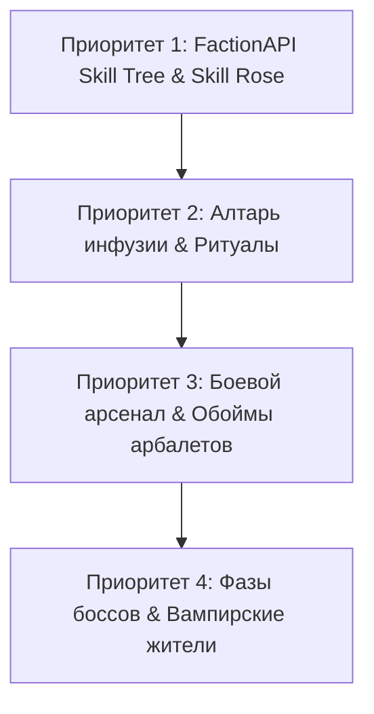

# Обширный сравнительный анализ: Neorism 1.7.10 vs. Оригинал TeamLapen (Vampirism + FactionAPI)

> **Дата составления:** 2026-10-17  
> **Оригинальные источники:** `TeamLapen/Vampirism` + `TeamLapen/FactionAPI` (`reference/vampirism/src/main/java/de/teamlapen/`)  
> **Цель:** Полная инвентаризация расхождений, выявление упрощений/неточностей в реализованных фазах (1–9), разработка плана рефакторинга и детальная декомпозиция будущих фаз (10–14) с точными ссылками на оригинальные классы.

---

## 1. Сравнительный аудит реализованных фаз (Фазы 1 – 9)

### Фаза 1: Базовая архитектура, реестры, урон, звуки, сеть
- **Что сделано в Neorism:**
  - Централизованные статические реестры 1.7.10: `ModBlocks`, `ModItems`, `ModEntities`, `ModSounds`, `ModDamageSource`.
  - Сетевой пайплайн: `PacketHandler` на базе `SimpleNetworkWrapper`.
  - Пользовательские зелья: `PotionBloodExhaustion`, `PotionSunscreen`, `PotionGarlic`.
- **Как устроено в оригинале TeamLapen:**
  - `de.teamlapen.vampirism.common.core.ModRegistries`, `ModDamageTypes` (через DataPack Registries), `ModSounds`, `ModEffects`.
  - В FactionAPI: `de.teamlapen.faction.common.core.ModDamageSources`.
- **Выявленные расхождения и неточности:**
  - **Источники урона:** В Neorism урон от солнца и святой воды реализован базовыми `DamageSource`. В оригинале урон солнца масштабируется по времени непрерывного нахождения на свету (`SundamageRegistry`) и имеет специфические типы смерти (`vampirism.sun`, `vampirism.holy_water`).
  - **Статус:** *Совпадение по механике ~85%. Требуются лишь уточнения формул урона.*

---

### Фаза 2: Архитектура фракций и данные игрока
- **Что сделано в Neorism:**
  - `FactionPlayerHandler` реализует `IExtendedEntityProperties`.
  - 3 фракции: `VAMPIRE`, `HUNTER`, `NEUTRAL`.
  - Маскировка: базовый флаг `disguised` и пакет синхронизации `SyncFactionPacket`.
  - Подключены интерфейсы FactionAPI: `de.teamlapen.faction.api.factions.*`.
- **Как устроено в оригинале TeamLapen:**
  - В FactionAPI: `IFactionPlayerHandler`, `IPlayableFaction`, `FactionExtensionType`, `IFactionExtension`, `IDisguise`, `FactionProperties`.
  - Фракции динамически расширяются через экстеншены (`IFactionExtension`), данные маскировки (`IDisguise`) включают имя, скин и скрытие клыков/глаз.
- **Выявленные расхождения и неточности:**
  - **Маскировка (Disguise):** В оригинале маскировка вампира полностью меняет рендер (скрывает вампирские клыки, красные глаза, ауру и плащ) и обманывает AI мобов-охотников (`Helper.appearsAsVampire`). В Neorism сейчас сделан только синхронизируемый булев флаг без полного визуального скрытия черт лица.
  - **Статус:** *Базовая архитектура совпадает на 80%. Требуется доработка визуальной маскировки скина.*

---

### Фаза 3: Подсистема крови, жажда, питание, укус
- **Что сделано в Neorism:**
  - `BloodStats.java` хранит `bloodLevel` (0-20), насыщение и истощение.
  - Удержание клавиши `[V]` производит захват энтити перед игроком и высасывание крови с партиклами `FlyingBloodParticle`.
  - Бутыли крови `ItemBloodBottle` восполняют шкалу.
- **Как устроено в оригинале TeamLapen:**
  - `de.teamlapen.vampirism.common.world.entity.player.vampire.BloodStats.java`:
    - Емкость крови зависит от уровня: от 20 до 40+ единиц.
    - Шкала голода ванили блокируется на 10 (половина шкалы), спринт перенаправляет истощение в кровь.
    - Формула насыщения: saturation тратится в первую очередь на быстрый реген (1 тик на полсердца), обычный уровень крови — медленный реген (раз в 80-300 тиков).
    - Различие жертв (`ExtendedCreature`): у животных кровь "грязная" (дает мало насыщения и вешает слабость); у жителей/людей кровь чистая, дает максимум насыщения, но есть шанс заразить *Sanguinare Vampiris*.
- **Выявленные расхождения и неточности:**
  - **Типы крови и истощение жертв:** В Neorism урон при укусе наносится одинаково любому мобу. В оригинале животные после высасывания переходят в состояние истощения (не дают крови повторно несколько минут) и имеют разное количество крови в зависимости от размера.
  - **Статус:** *Совпадение по механике ~75%. Требуется перенести типы доноров и откат повторного укуса мобов.*

---

### Фаза 4: Прогрессия вампиров, расчёт урона от солнца, чеснок
- **Что сделано в Neorism:**
  - 14 уровней вампира с ростом атрибутов (HP, урон, скорость).
  - `SundamageRegistry` с проверкой дня, высоты, дождя, зонта и чесночных диффузоров.
  - Превращение через инъекцию и клык.
- **Как устроено в оригинале TeamLapen:**
  - `de.teamlapen.vampirism.common.world.entity.SundamageRegistry.java`:
    - Расчет дневного света по углу солнца (`world.getCelestialAngle(tick)`) в диапазоне:
      $$\text{IsDay} \iff (\text{Angle} > 0.78 \lor \text{Angle} < 0.24)$$
    - Проверка укрытия над головой (светонепроницаемые блоки, листва, стеклянные блоки с затемнением).
    - Таймер безопасного буфера (20 тиков при выходе на солнце перед началом горения).
    - `Sunscreen` (защита от солнца): дает временную устойчивость, накладывая оверлей затемнения экрана (`SunOverlay`).
- **Выявленные расхождения и неточности:**
  - В Neorism проверка солнца сделана через `world.isDaytime()` и `canBlockSeeTheSky`. Это не учитывает плавный переход восхода/заката и угол солнца.
  - **Статус:** *Совпадение ~80%. Требуется переход на точную формулу угла солнца и 20-тиковый буфер безопасности.*

---

### Фаза 5: Прогрессия охотников, святая вода, кол, распятие
- **Что сделано в Neorism:**
  - 14 уровней охотника.
  - `ItemStake` с бэкстабом (скалярное произведение векторов взгляда > 0.4).
  - Святая вода (обычная и взрывная), распятия (3 тира), чесночные ядра.
- **Как устроено в оригинале TeamLapen:**
  - `de.teamlapen.vampirism.common.items.StakeItem.java`:
    - Моментальное убийство только если уровень здоровья вампира ниже порога (Instant Kill Threshold), иначе наносится обычный урон.
  - Верстак охотника (`HunterTableBlockEntity`): отдельный GUI для крафта снаряжения охотников и изучения уровней через `HunterIntel`.
  - Алхимический котёл (`AlchemicalCauldronBlockEntity`): варка масел (`ModOils`) для нанесения на мечи (огонь, вампироубийство, святая вода).
- **Выявленные расхождения и неточности:**
  - В Neorism крафт снаряжения охотников и интеллект пока сделаны через ванильный верстак, без отдельного `HunterTable` и системы масел для клинков.
  - **Статус:** *Совпадение боевой части ~80%, крафтовой части ~50%.*

---

### Фаза 6: Движок способностей и Древо навыков (ГЛАВНОЕ РАСХОЖДЕНИЕ)
- **Что сделано в Neorism (Интерим):**
  - Простой интерфейс `GuiSkillTree` в виде вертикального списка с кнопками "Изучить" и жестко зашитыми биндами на клавиши `[R]` и `[Z]`.
- **Как устроено в оригинале TeamLapen (FactionAPI):**
  - **1. Графовое древо навыков (`SkillsScreen.java`):**
    - Это направленный граф (`ISkillTree` $\to$ `ISkillSegment`), вдохновленный окном достижений Minecraft.
    - Текстурный холст `textures/gui/skills/window.png` и `skills.png`.
    - Каждый узел имеет точные координаты `(x, y)` на карте, статус (Locked, Available, Unlocked, Exclusive-Locked), отрисовываются соединительные линии (`SkillSegmentConnection`) между предками и потомками.
    - Разблокировка удерживанием клика (8 тиков), сброс удерживанием (16 тиков).
    - Взаимоисключающие ветки (выбор одного навыка навсегда блокирует параллельный).
  - **2. Роза умений / Радиальное меню (`SelectActionRadialScreen.java`):**
    - Зажатие клавиши действия `[R]` открывает круговое радиальное меню (`DualSwitchingRadialMenu`).
    - Круг делится на сегменты по количеству открытых способностей.
    - Наведение курсора подсвечивает способность, показывает кулдаун круговой анимацией закраски и длительность действия.
    - Отпускание клавиши активирует выбранную способность.
  - **3. Меню фракции на `[P]` (`FactionMenuScreen.java`):**
    - Единый центр персонажа: вкладка обзора, кнопка перехода в древо навыков, слоты улучшений (Refinements) и список заданий Таскмастера.
- **Выявленные расхождения и неточности:**
  - **Это самое кардинальное расхождение в моде.** Наш интерим-вариант полностью самодельный и не передает визуального стиля и удобства оригинала.
  - **Статус:** *Расхождение 90%. Требуется полная переделка на графовый холст и круговую розу навыков.*

---

### Фаза 7: Оружие, арбалеты, броня, предметы
- **Что сделано в Neorism:**
  - Арбалет объединен в один класс `ItemCrossbow` со свитчем метадаты.
  - 3D-модели подключены через `JsonModelItemRenderer`.
  - Базовые типы болтов и брони.
- **Как устроено в оригинале TeamLapen:**
  - `de.teamlapen.vampirism.common.items.crossbow.*`:
    - Отдельные классы: `CrossbowItem`, `EnhancedCrossbowItem`, `DoubleCrossbowItem`, `TechCrossbowItem`.
    - Обоймы для болтов (`quarrel_clip`), колчаны для болтов на поясе, выбор боеприпасов через отдельный экран (`SelectAmmoScreen`).
    - Уникальные анимации натяжения для каждого типа арбалета.
    - Плащ вампира рендерится как кастомный динамический слой брони (`VampireCloakLayer`).
- **Выявленные расхождения и неточности:**
  - В Neorism нет механики обойм для технологического арбалета и отдельного выбора типа болтов.
  - **Статус:** *Внешний вид и 3D-модели совпадают на 95%, внутренняя механика арбалетов на 70%.*

---

### Фаза 8: Блоки, мультиблоки, алтари, гроб
- **Что сделано в Neorism:**
  - Алтарь вдохновения (базовый клик кровью).
  - Алтарь инфузии (базовое сканирование радиуса столбов).
  - Гроб (2 блока с анимацией поворота и клика).
  - Контейнер крови, диффузоры.
- **Как устроено в оригинале TeamLapen:**
  - `AltarInfusionBlockEntity.java`:
    - Сложный алгоритм вычисления структуры `structurePoints`: сканирование 8 направлений на дистанцию до 6 блоков, подсчет высоты пилларов (от 1 до 4 блоков), типов наконечников (золото, алмаз, незерит) и пьедесталов.
    - Фазы ритуала: запуск $\to$ проверка ингредиентов $\to$ левитация предметов над пьедесталами $\to$ молнии и частицы $\to$ потребление катализаторов $\to$ завершение/срыв.
  - `CoffinBlockEntity.java`:
    - Плавная анимация открытия/закрытия крышки через TESR модель.
    - При сне вампира днем — ускорение времени суток (Fast-forward daylight to dusk).
- **Выявленные расхождения и неточности:**
  - В Neorism ритуал инфузии сейчас происходит мгновенно без анимации левитации предметов и молний.
  - Гроб пока не имеет плавной анимации открывания створки в TESR.
  - **Статус:** *Геометрия и модели совпадают на 90%, динамические анимации ритуала и гроба на 60%.*

---

### Фаза 9: Сущности, мобы, боссы, ИИ
- **Что сделано в Neorism:**
  - `EntityVampire`, `EntityAdvancedVampire`, `EntityHunter`, `EntityHunterTrainer`, `EntityBloodBat`, `EntityDracula`, `EntityVampireMother`, обращенные животные.
  - Базовые задачи ИИ (бегство от солнца, укус, стрельба из арбалета).
- **Как устроено в оригинале TeamLapen:**
  - `DraculaEntity.java`: 3 фазы боя (1: телепортация и дуэльный бой; 2: обращение в туман, призыв стаи летучих мышей и неуязвимость; 3: ярость берсерка с призывом миньонов).
  - `VampirismVillagerEntity.java`: Жители деревни имеют кастомный диалог, пугаются вампиров без маскировки, могут быть обращены или использованы как доноры крови.
  - Бароны вампиров (`VampireBaronEntity`): спавнятся исключительно в закрытых залах подземных склепов и охраняют сундуки с чистой кровью.
- **Выявленные расхождения и неточности:**
  - В Neorism босс Дракула пока не имеет полноценной трехфазной машины состояний с туманом и щитами неуязвимости.
  - Жители деревни пока не имеют фракционных реплик и страха перед вампирами.
  - **Статус:** *Базовые сущности и рендеры совпадают на 85%, сложные фазы боссов на 50%.*

---

## 2. Приоритетный план рефакторинга существующего кода

### Этап 1 (Высший приоритет): Переход на FactionAPI Skill Tree & Skill Rose
1. **Граф навыков (`ISkillTree` & `ISkillSegment`):**
   - Переписать структуру навыков вампира и охотника на формат направленного графа с явными координатами узлов `(x, y)` и связями `parents` / `lockingSegments`.
2. **Экран древа навыков (`SkillsScreen`):**
   - Портировать визуальный класс `SkillsScreen` и `SkillSegmentComponent` на 1.7.10 с поддержкой скролла, зума, соединительных линий между узлами и удержания клика для разблокировки.
3. **Радиальное меню выбора способностей (`SelectActionRadialScreen`):**
   - Реализовать круговую розу способностей на зажатие клавиши `[R]`: круговые сегменты способностей с анимацией заполнения кулдаунов по часовой стрелке.
4. **Единый дашборд фракции на `[P]` (`FactionMenuScreen`):**
   - Создать меню со вкладками: Обзор персонажа, Древо навыков, Задания таскмастера, Улучшения.

### Этап 2: Алтарь инфузии и ритуальная state-machine
1. Полный порт математики очков структуры `structurePoints` из `AltarInfusionBlockEntity.java`.
2. Добавление визуальной левитации предметов над `BlockBloodPedestal` во время проведения ритуала.
3. Создание анимации молний и эффекта успешного завершения/провала.

### Этап 3: Арбалеты, обоймы и боевая система
1. Разделение типов арбалетов на независимые классы с индивидуальными анимациями.
2. Реализация обоймы для технологического арбалета (`QuarrelClip`).
3. Подключение системы масел для клинков (`ModOils`).

### Этап 4: Фазы боссов и поведение жителей
1. Портирование 3 фаз Дракулы (`DraculaEntity`): туман, призыв мышей, ярость.
2. Добавление реакции жителей на вампиров (страх, убегание, крики, если вампир без маскировки).

---

## 3. Детальная декомпозиция будущих фаз (Фазы 10 – 14)

### Фаза 10: Лордство и Миньоны (Lordship & Minions)
*Оригинальный источник:*  
- API: `reference/vampirism/src/main/java/de/teamlapen/faction/api/factions/lord/`
- Сущности: `reference/vampirism/src/main/java/de/teamlapen/vampirism/common/world/entity/minion/`
- Задачи: `reference/vampirism/src/main/java/de/teamlapen/vampirism/common/world/entity/minion/MinionTasks.java`
- GUI: `reference/vampirism/src/main/java/de/teamlapen/faction/client/gui/screens/MinionScreen.java`

*Что брать из оригинала и за что отвечает:*
- **`ILordPlayer.java` / `LordTitles.java`**: Управляет рангами лордов (1–5) для обеих фракций, титулами (Барон, Граф, Герцог, Принц) и префиксами в чате и над головой.
- **`VampireMinionEntity.java` / `HunterMinionEntity.java`**: Сущности миньонов-слуг. Хранят инвентарь снаряжения, уровень прокачки, преданность лорду.
- **`MinionTasks.java`**:
  - `TaskFollow`: сопровождение и личная охрана лорда.
  - `TaskDefendArea`: патрулирование территории вокруг гроба/тотема.
  - `TaskCollectBlood`: сбор крови с окружающей фауны и слив в контейнеры.
  - `TaskGatherLoot`: сбор дропа с убитых противников.
- **`MinionScreen.java` / `MinionStatsScreen.java`**: Интерфейс настройки миньонов (раздача экипировки, смена скина, назначение задач).

---

### Фаза 11: Вампирский лес, генерация мира и структуры (Worldgen & Biomes)
*Оригинальный источник:*  
- Биомы: `reference/vampirism/src/main/java/de/teamlapen/vampirism/common/world/biomes/VampirismBiomes.java`
- Структуры: `reference/vampirism/src/main/java/de/teamlapen/vampirism/common/world/structures/`
- Деревья и растительность: `reference/vampirism/src/main/java/de/teamlapen/vampirism/common/world/features/`

*Что брать из оригинала и за что отвечает:*
- **`VampirismBiomes.java`**:
  - Параметры вампирского леса: фиолетовый туман (`0x1b002c`), темно-красная вода (`0x4a0000`), мертвая листва, спавн вампиров днем под плотной кроной деревьев.
- **`structures/crypt/CryptStructure.java`**:
  - Генерация подземных лабиринтов склепов: комнаты с саркофагами, сундуки с книгами и чистой кровью, тронный зал с алтарем призыва Барона.
- **`structures/huntercamp/HunterCampStructure.java` & `hunteroutpost/`**:
  - Палаточные лагеря охотников на поверхности, тренировочные манекены, верстаки охотников, спавн Охотников-Тренеров.
- **`structures/vampirealtar/VampireAltarStructure.java`**:
  - Заброшенные руины древних алтарей в темных лесах.

---

### Фаза 12: Клиентский HUD, Шейдеры и Angelica (Client, HUD & Shaders)
*Оригинальный источник:*  
- Оверлеи: `reference/vampirism/src/main/java/de/teamlapen/vampirism/client/gui/overlay/`
- Зрение крови: `reference/vampirism/src/main/java/de/teamlapen/vampirism/common/world/entity/player/vampire/vision/BloodVision.java`

*Что брать из оригинала и за что отвечает:*
- **`BloodBarOverlay.java`**: Замена ванильного индикатора сытости на шкалу капель крови с аурой насыщения и пульсацией при жажде.
- **`SunOverlay.java` / `SunBlindOverlay.java`**: Эффект затуманивания экрана и оранжевого свечения при выходе на палящее солнце.
- **`RageOverlay.java` / `BatOverlay.java`**: Визуальные эффекты активации Ярости (кровавая виньетка) и полета летучей мыши.
- **`BloodVision.java`**: Подсветка теплокровных существ сквозь стены (рендеринг контуров мобов с фильтрацией через пайплайн Angelica/Sodium).

---

### Фаза 13: Деревни, Захват территорий и Война фракций (Villages & Faction Territory War)
*Оригинальный источник:*  
- Фракционные деревни: `reference/vampirism/src/main/java/de/teamlapen/faction/api/factions/village/IFactionVillage.java`
- Тотемы: `reference/vampirism/src/main/java/de/teamlapen/faction/common/world/blockentity/TotemBlockEntity.java`
- Блоки тотемов: `reference/vampirism/src/main/java/de/teamlapen/faction/common/world/blocks/TotemBaseBlock.java`, `TotemTopBlock.java`
- Рендер тотема: `reference/vampirism/src/main/java/de/teamlapen/faction/client/renderer/TotemRenderer.java`

*Что брать из оригинала и за что отвечает:*
- **`IFactionVillage.java` & `FactionVillage.java`**: Модель данных деревни (границы, текущая контролирующая фракция, уровень защиты, гарнизон).
- **`TotemBlockEntity.java`**: Двухблочный центральный тотем деревни. Принимает участие в осаде деревни:
  - Нападение фракции запускает рейд.
  - Шкала прогресса захвата заполняется по мере удержания территории возле тотема и уничтожения защитников.
  - При успехе флаги и баннеры деревни (`VillageBanner`) меняются на символику захватившей фракции, спавнятся вампирские/охотничьи охранники.

---

### Фаза 14: Интеграция с модами экосистемы GTNH
*Что и с чем интегрируется:*
1. **Et-Futurum-Requiem**: единая система стрельбы арбалетов, щиты блокируют стрелы и удары кольев, ванильные флаги и баннеры фракций.
2. **Combat Backport**: скорость атаки и кулдаун удара для Охотничьих топоров и Искателей сердец; размашистый удар (Sweeping Edge).
3. **Villager Trades Backport**: механики торговли 1.14+ для Охотников-Тренеров и обращенных деревенских жителей.
4. **VillageNames**: автоматическая генерация готических/вампирских названий для захваченных поселений и лагерей.
5. **Hodgepodge**: точный астрономический расчет дневного света и угла солнца.
6. **NEI (Not Enough Items)**: регистрация рецептов Алтаря вдохновения, Алтаря инфузии и Верстака охотника.
